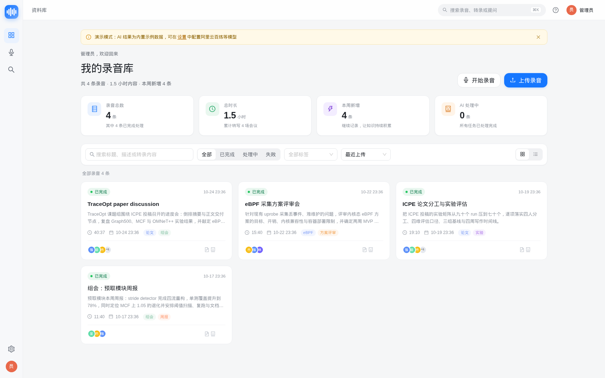
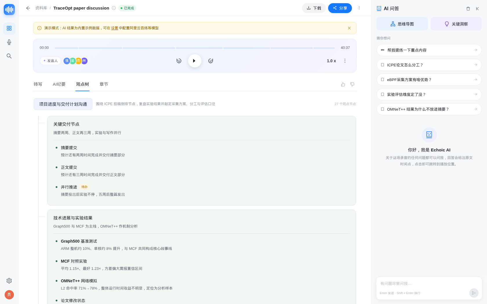
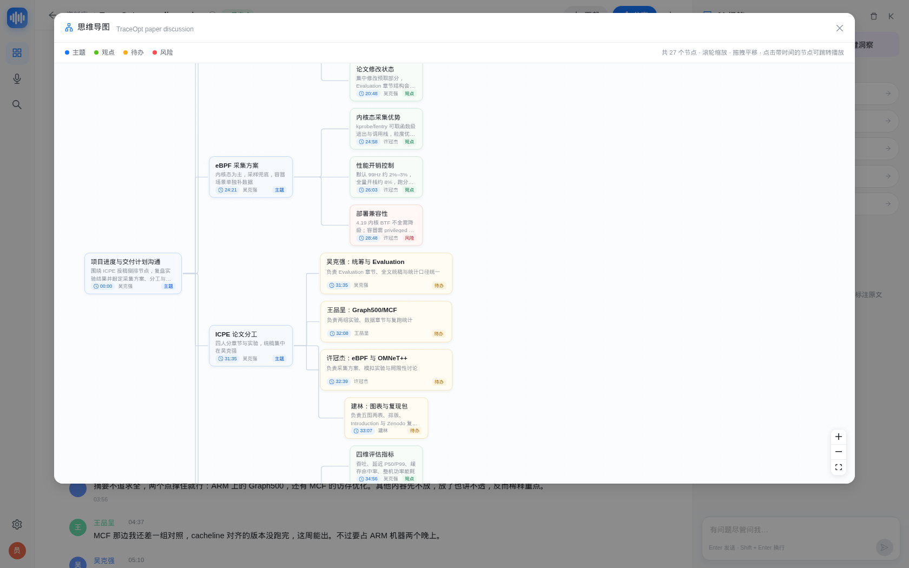
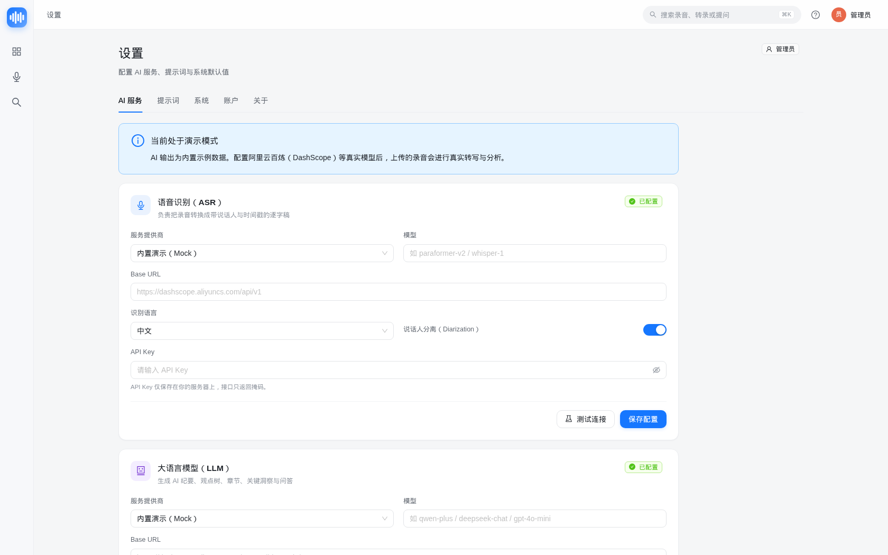

# Echoic

> 自托管的私人**会议 / 通话 / 录音 / 视频知识库**。
> 上传或网页录制声音，自动获得**转录稿、AI 纪要、观点树 & 思维导图、章节、关键洞察、待办与 AI 问答**——所有数据都留在你自己的服务器上。

- 定位：paperless-ngx 之于纸质文档 = **Echoic 之于录音**
- 风格参考：飞书妙记 / 钉钉闪记（详情页 1:1 神似）
- 版本：v0.1.0（MVP，可私有化部署）
- 许可：MIT

## 📸 界面预览

> 以下截图来自本仓库真实运行的 Demo 数据（1680×1050，完整 6 张见 [`docs/screenshots/`](docs/screenshots/)）。

| 资料库 | 详情页 · 观点树 |
|---|---|
|  |  |

| AI 思维导图 | 设置 · AI 服务 |
|---|---|
|  |  |

---

## ✨ 功能特性

| 能力 | 说明 |
|---|---|
| 🎙 网页录音 + 上传 | 浏览器直接麦克风录音（计时/暂停/电平表）；支持 mp3/wav/m4a/aac/ogg/webm/mp4/mov/mkv，单文件 ≤ 2GB |
| 📝 语音转写 | 可配置阿里云百炼 DashScope / OpenAI 兼容 Whisper / Mock；输出带说话人和时间戳的分段转录稿，可改名、可编辑 |
| 🧠 AI 纪要 | Markdown 概述 + 关键结论 + 决议 + 待办；支持重新生成 |
| 🌳 观点树 & 思维导图 | 结构化观点树，React Flow 思维导图可视化，点击节点跳转对应录音时间 |
| 📑 智能章节 | 自动切分章节（标题/时间区间/摘要/bullets），点击跳播 |
| 💬 AI 问答 | 基于转录稿 + 纪要的 RAG 问答，SSE 流式输出，答案带 `[12:05]` 时间戳引用，可点击定位 |
| 📚 资料库 | 搜索 / 状态筛选 / 标签 / 排序 / 统计卡片；全局搜索定位到录音片段 |
| 🎧 播放器 | 进度拖动、±15 秒、倍速、当前段落高亮自动滚动、HTTP Range 按需加载 |
| 💾 数据自持 | SQLite（可选 PostgreSQL）+ 本地媒体目录；备份 = 打包一个数据卷 |
| 🔐 安全 | HttpOnly Cookie JWT、bcrypt 密码、Fernet 加密 API Key（仅回掩码）、上传校验、登录限速 |
| 🎭 演示模式 | 零 API Key、零外网也能完整跑通全流程（内置示例录音与全套 AI 结果） |
| 📤 数据导出 | 转录稿导出 TXT / SRT / Markdown / JSON |
| 🐳 一键部署 | 多阶段 Docker 镜像 + docker compose，`up -d` 即用；可切独立 worker / PostgreSQL |

---

## 🏗 架构一览

```
┌──────────────────────── 浏览器（React 18 + TS + Vite + AntD 5）────────────────────────┐
│  资料库 · 录音上传 · 详情页(转写 | AI纪要 | 观点树 | 章节) · AI问答面板 · 思维导图 · 设置  │
└───────────────────────────────────┬────────────────────────────────────────────────────┘
                                    │ 同源 HTTPS · HttpOnly Cookie JWT · SSE
┌───────────────────────────────────▼────────────────────────────────────────────────────┐
│ FastAPI（单进程，uvicorn）                                                              │
│  /api/auth /api/recordings /transcript /insights /chat(SSE) /search /tags /settings …  │
│  ├─ core：config · security · crypto · storage · media(ffmpeg)                          │
│  ├─ providers：ASR / LLM / Embedding 可插拔（mock / DashScope / OpenAI 兼容）             │
│  ├─ services：pipeline 处理管线 · queue 任务队列 · chat RAG · analysis · demo             │
│  └─ 内嵌 worker 线程（可切独立进程）；生产模式直接托管前端静态资源                         │
└──────┬──────────────────────────────────────────────┬──────────────────────────────────┘
       │ SQLAlchemy 2.0                               │ 本地文件系统（挂载卷 /data）
┌──────▼──────────────┐                    ┌──────────▼────────────────────────────────┐
│ SQLite (默认，WAL)   │                    │ echoic.db · secret.key · media/{uuid}/…   │
│ PostgreSQL (可选)    │                    │ original.* · playback.m4a · asr.wav       │
└─────────────────────┘                    └───────────────────────────────────────────┘
       │
       ▼ 仅出站 HTTPS（可用自建/内网兼容端点替代）
  阿里云百炼 DashScope（paraformer 实时 ASR / qwen LLM / embedding）
  OpenAI 兼容 LLM（DeepSeek / Ollama / vLLM / LM Studio…）
  Whisper 兼容 ASR（OpenAI / faster-whisper-server / FunASR…）
```

处理管线：

```
upload/record → 落盘 + ffprobe → [prepare] 标准化 16k wav + playback.m4a
             → [transcribe] ASR（说话人分离）→ [analyze] LLM 纪要/章节/观点树/洞察/待办
             → [embed] 切片+向量（可选）→ [finalize] status=ready
失败 → status=failed + 中文 error_message，可重试；进度写 progress/stage 供前端轮询
```

更多设计细节：[ARCHITECTURE.md](docs/ARCHITECTURE.md) · [PIPELINE.md](docs/PIPELINE.md) · [API.md](docs/API.md) · [FRONTEND.md](docs/FRONTEND.md)

---

## 🚀 快速开始（Docker，推荐）

```bash
cp .env.example .env      # 修改 ECHOIC_ADMIN_PASSWORD（默认 admin123 仅用于首次体验）
docker compose up -d --build
```

打开 <http://localhost:8000>，用 `.env` 中的管理员账号登录（默认 **admin / admin123**）。

- 默认 **mock 演示模式**：无需任何 API Key，启动即有示例录音与全套 AI 结果；
- 接入真实模型：在「设置 → AI 服务」填写 DashScope / OpenAI 兼容端点的 Key 与模型，点「测试连接」即可；
- 数据/媒体/密钥全部落在 `echoic-data` 卷，备份该卷即可迁移。

完整部署（反向代理、备份恢复、升级、PostgreSQL、独立 worker、故障排查）见 **[docs/DEPLOYMENT.md](docs/DEPLOYMENT.md)**。

> ⚠️ **验证边界**：本项目的本地验证在未启用 Docker 的 WSL 环境中完成（Docker CLI 不可用），因此 `Dockerfile` / `docker-compose.yml` 已做静态校验（YAML、路径、指令、脚本语法），但**镜像构建与容器运行未在真实 Docker 主机上执行**。请首次部署时按 [docs/DEPLOYMENT.md](docs/DEPLOYMENT.md) 在目标机复跑并记录；阿里云真实 Key 的端到端调用同样需在目标机验证（Mock / 离线路径已全量验证）。

---

## ✅ 验证状态（v0.1.0，2026-10-26）

| 项目 | 结果 | 证据 |
|---|---|---|
| 后端测试 | **129 passed**（pytest，含 API 102 + 管线/Provider/演示数据 27） | `cd backend && .venv/bin/pytest -q` |
| 前端构建 | **通过**（`tsc --noEmit` 零错误；vite 产物 gzip ≈ 499 KB JS + 16 KB CSS） | `cd frontend && npm run build` |
| 端到端冒烟（Mock 模式，全新数据库） | **30 / 30 PASS**：登录/权限、演示数据、转录/分析、真实上传→管线就绪、改说话人/改段落、导出、搜索、SSE 问答、设置、Range 媒体、重算、删除 | [`e2e/last-run.log`](e2e/last-run.log) · [`e2e/REPORT.md`](e2e/REPORT.md) |
| UI 截图巡检 | **6 / 6 张**，无布局溢出、无未捕获异常、无 5xx | [`docs/screenshots/`](docs/screenshots/) |
| Docker | 配置静态校验通过；**未在真实 Docker 环境运行**（见上方验证边界） | `docs/DEPLOYMENT.md` |


## 🛠 开发指南

依赖：Python 3.11+（推荐 3.12）、Node.js 20+（推荐 22）、ffmpeg。

```bash
# 后端 + 前端（热更新）：后端 http://127.0.0.1:8000，前端 http://localhost:5173
./scripts/dev.sh

# 类生产本地运行：构建前端后由 FastAPI 同源托管，:8100
./scripts/run-local.sh

# 一键验证：pytest + 前端类型检查/构建 + 健康检查 + e2e 冒烟
./scripts/verify.sh
```

手工方式：

```bash
# 后端
cd backend
python3 -m venv .venv && .venv/bin/pip install -r requirements-dev.txt
.venv/bin/uvicorn app.main:app --reload --port 8000

# 前端（dev server 已代理 /api → :8000）
cd frontend
npm ci        # 或 npm install
npm run dev
```

目录结构：

```
backend/app/{api,core,providers,services}   FastAPI 应用与插件式 AI provider
backend/app/{main.py,config.py,models.py,…} 应用装配 / 配置 / ORM / DTO
frontend/src/{pages,components,layouts,api}React 前端
docker/{entrypoint.sh}                      容器入口脚本
scripts/{dev.sh,run-local.sh,verify.sh}     本地开发 / 验收脚本
docs/                                       架构、管线、API、前端、部署文档
e2e/                                        端到端冒烟脚本与验收报告
```

---

## ⚙️ 配置说明

所有配置均可通过环境变量 `ECHOIC_*` 或 `backend/.env` / 仓库根目录 `.env` 覆盖，完整清单与注释见 [.env.example](.env.example)。常改项：

| 变量 | 默认 | 说明 |
|---|---|---|
| `ECHOIC_ADMIN_USERNAME` / `ECHOIC_ADMIN_PASSWORD` | `admin` / `admin123` | 首次启动创建的管理员（之后请在设置页改密） |
| `ECHOIC_SECRET_KEY` | 自动生成 | JWT / API Key 加密密钥；留空自动生成到数据目录 |
| `ECHOIC_DATA_DIR` | `./data`（Docker 内 `/data`） | SQLite、媒体、密钥存放目录 |
| `ECHOIC_DATABASE_URL` | 空（SQLite） | 可指向 PostgreSQL：`postgresql+psycopg://…` |
| `ECHOIC_DEMO_SEED` | `true` | 空库时写入内置演示录音 |
| `ECHOIC_EMBEDDED_WORKER` | `true` | 内嵌任务线程；独立 worker 部署时设 `false` |
| `ECHOIC_MAX_UPLOAD_MB` | `2048` | 单文件上传上限 |
| `ECHOIC_ASR_PROVIDER` / `ECHOIC_LLM_PROVIDER` | `mock` / `mock` | AI provider（mock / dashscope_realtime / openai …） |
| `ECHOIC_ASR_API_KEY` / `ECHOIC_LLM_API_KEY` | 空 | 服务商密钥（首次启动写入数据库；网页设置优先） |

> 提示：`.env` 中的 `ECHOIC_*AI*` 配置**只在首次启动写入数据库**，之后请在「设置」页面修改（即时生效、Key 加密存储）。

---

## 🗺 Roadmap（v0.1 非目标）

- [ ] 多用户 / 团队协作 / 分享链接与细粒度权限
- [ ] 实时转写与实时字幕（边录边出字）
- [ ] 视频画面 PPT / 场景抽取
- [ ] 邮件 / 扫描目录自动导入（paperless 式 consume 目录）
- [ ] 移动 App / 浏览器扩展
- [ ] 向量数据库（pgvector / Qdrant）与混合检索增强
- [ ] 回收站 / 审计日志 / OAuth / LDAP
- [ ] 回收站与批量操作、跨录音主题聚合

---

## 📄 License

[MIT License](LICENSE) © 2026 Echoic contributors.

---

## 🔗 文档索引

| 文档 | 内容 |
|---|---|
| [docs/ARCHITECTURE.md](docs/ARCHITECTURE.md) | 目标/非目标、总体架构、数据模型、安全设计 |
| [docs/PIPELINE.md](docs/PIPELINE.md) | 处理管线、任务队列、provider 接口、mock 行为 |
| [docs/API.md](docs/API.md) | REST + SSE 接口契约（前后端唯一事实来源） |
| [docs/FRONTEND.md](docs/FRONTEND.md) | 页面/路由/组件/视觉规范 |
| [docs/DEPLOYMENT.md](docs/DEPLOYMENT.md) | 中文部署指南（Docker、备份、升级、排障） |
| [docs/01-需求与竞品分析.md](docs/01-需求与竞品分析.md) | 需求基线、竞品对比、NFR、风险 |
| [docs/05-产品与UX设计.md](docs/05-产品与UX设计.md) | 信息架构、用户旅程、页面交互、设计规范 |
| [docs/07-实施计划与验收.md](docs/07-实施计划与验收.md) | WBS、里程碑、测试策略、发布验收清单 |
| [docs/research/dashscope-api.md](docs/research/dashscope-api.md) | 阿里云百炼 ASR/LLM/Embedding API 调研与集成建议 |
| [e2e/REPORT.md](e2e/REPORT.md) | 端到端验收报告（PASS/FAIL、截图、已知问题） |
| [CHANGELOG.md](CHANGELOG.md) | 版本变更记录与已知限制 |
