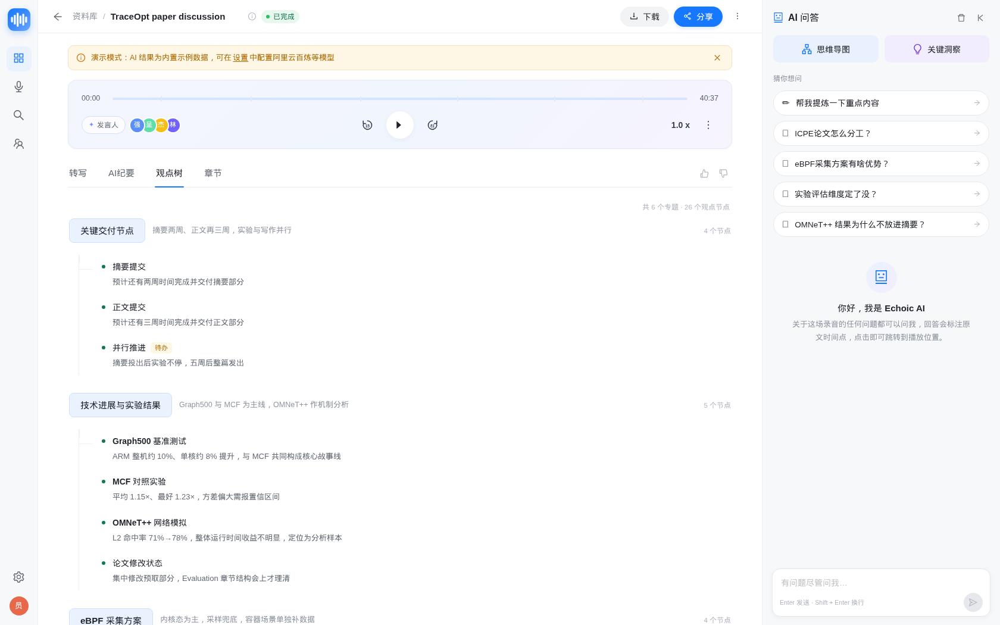

# Echoic

**English** | [简体中文](README.zh-CN.md)

[](https://github.com/wpcwzy/echoic/actions/workflows/ci.yml)
[](https://github.com/wpcwzy/echoic/actions/workflows/docker-publish.yml)
[](https://github.com/wpcwzy/echoic/pkgs/container/echoic)
[](LICENSE)

> A self-hosted private knowledge base for **meetings, calls, voice recordings and videos**.
> Upload a file or record from the browser, and get a **transcript, AI minutes, viewpoint tree & mind map, chapters, key insights, action items and AI Q&A** — with all data staying on your own server.

- Positioning: what paperless-ngx is to paper documents, **Echoic is to recordings**
- Version: **v0.3.13** — P1 complete + sqlite-vec, live captions GA, registration/profile, auto descriptions (dark theme, trash & batch, object storage, vector/hybrid search, multi-user & sharing, CI/CD + multi-arch GHCR images)
- License: MIT

## 📸 Screenshots

> Captured from the built-in demo data. More in [`docs/screenshots/`](docs/screenshots/).

| Library | Recording detail · viewpoint tree |
|---|---|
|  |  |

| AI mind map | Settings · AI providers |
|---|---|
|  |  |

**v0.3 dark theme, trash, live & search**

| Library · dark | Live captions (record page) |
|---|---|
|  |  |

| Trash & batch actions | Semantic / hybrid search |
|---|---|
|  |  |

| Viewpoint forest (multiple topic trees) |
|---|
|  |

**v0.2 collaboration & sharing**

| User & role management | Create a share link |
|---|---|
|  |  |

| Public share page (no login) | Password-protected share |
|---|---|
|  |  |

---

## ✨ Features

| Capability | Details |
|---|---|
| 🎙 Browser recording + upload | Record directly from the microphone (timer / pause / level meter); supports mp3/wav/m4a/aac/ogg/webm/mp4/mov/mkv up to 2 GB per file |
| 📝 Speech-to-text | Plug-and-play providers: Alibaba Cloud DashScope / OpenAI-compatible Whisper / Mock; transcript with speaker labels and timestamps, renameable and editable |
| 🧠 AI minutes | Markdown summary + key conclusions + decisions + action items; regenerable |
| 🌳 Viewpoint forest & mind map | Long meetings are distilled into multiple independent topic trees (a "forest"), each rendered with its own branches; interactive mind map; click any node to seek in the recording |
| 📑 Smart chapters | Automatic chapter segmentation (title / time range / summary / bullets); click to jump |
| 💬 AI Q&A | RAG over transcripts + minutes, streamed over SSE, answers cite `[12:05]` timestamps that seek the player |
| 📚 Library | Search / status filters / tags / sorting / stats; global search jumps to the matching transcript segment |
| 🎧 Player | Drag-to-seek, ±15 s, playback speed, chapter ticks, active-line highlighting, HTTP Range streaming |
| 👥 Speaker tools | Rename speakers, edit segments, and merge multiple mis-diarized speakers into one (transcript/timestamps preserved) |
| 🏷 Custom tags | Any user can create tags and add/remove them on recordings (detail editor + batch); tag rename/delete stays admin-only |
| 💾 Data ownership | SQLite (optional PostgreSQL) + local media directory; backup = archive one data volume |
| 🔐 Security | HttpOnly cookie JWT, bcrypt passwords, Fernet-encrypted API keys (masked in responses), upload validation, login rate limiting |
| 👤 Registration & profile | Public /register (gated by admin toggle) with auto-login; self-service /profile for display name/email/password; admin user management unchanged |
| 📝 Auto descriptions | Recordings get a concise one-line description from the AI summary after processing (falls back to transcript); user edits are never overwritten |
| 🎭 Demo mode | Full workflow with zero API keys and zero internet access (bundled demo recordings + complete AI results) |
| 👥 Multi-user & roles | `admin` / `member`; admin user management (create / edit / disable / reset password / delete), registration switch; recordings are owner-scoped and admins can transfer ownership; disabled accounts lose sessions immediately |
| 🔗 Share links | One-click sharing from the detail page: optional password, expiry (1 h – never), include transcript/minutes, allow download; public read-only page `/s/{token}` with revoke and view counters |
| 📥 Consume directory | Drop audio/video into `data/consume/` and it is imported and processed automatically (paperless-style); sha256 dedupe, failures quarantined, status and manual scan in Settings |
| 🌙 Dark theme | Light / Dark / System three-state switch, persisted per browser, no flash on reload; covers every page, modal, mind map, player and the public share page |
| 🗑 Trash & batch operations | Soft delete with 30-day retention, restore or permanently purge, automatic share revocation; multi-select batch trash/restore/purge/reprocess/tag, partial-success reporting and undo toast |
| 🪣 Object storage | Pluggable `local` / S3-compatible backend (MinIO); pipeline staging, Range media proxy, optional presigned redirects, delete cascades and local↔S3 migration CLI |
| 🎙 Live transcription (GA) | In-browser live captions via WebSocket + PCM worklet; mock provider offline, DashScope paraformer-realtime provider; automatic reconnect/resume within 120s (1s/2s/4s backoff), merge policies `replace` / `promote` |
| 🗣 Independent ASR slots | File transcription (whole recording, speaker diarization) and realtime captions can use separate providers / models / API keys / regions simultaneously; realtime defaults to reusing the file-transcription key |
| 🔎 Semantic & hybrid search | Vector index over transcript chunks (numpy / **sqlite-vec** / experimental pgvector with auto-degrade), hybrid RRF retrieval with ACL; semantic search UI, index status/rebuild, hybrid RAG for AI Q&A |
| 📤 Export | Transcript export as TXT / SRT / Markdown / JSON |
| 🐳 One-command deploy | Prebuilt multi-arch **GHCR image** (amd64/arm64, published by CI) + image-first docker compose: `pull && up -d`; source builds supported; optional standalone worker / PostgreSQL |
| 📱 Installable PWA | Add Echoic to the phone home screen from Chrome/Safari; standalone display, app-shell offline cache, mobile bottom navigation and safe-area support (HTTPS required) |

---

## 🏗 Architecture

```
┌──────────────────────── Browser (React 18 + TS + Vite + AntD 5) ────────────────────────┐
│  Library · Record & upload · Detail (transcript | minutes | viewpoint tree | chapters)  │
│  AI Q&A panel · Mind map · Settings · Users · Public share page                         │
└───────────────────────────────────────┬─────────────────────────────────────────────────┘
                                        │ same-origin HTTPS · HttpOnly cookie JWT · SSE
┌───────────────────────────────────────▼─────────────────────────────────────────────────┐
│ FastAPI (single process, uvicorn)                                                       │
│  /api/auth /api/recordings /transcript /insights /chat(SSE) /search /tags /settings …   │
│  /api/users /api/shares /api/public/shares /api/system/consume …                        │
│  ├─ core: config · security · crypto · storage · media (ffmpeg)                         │
│  ├─ providers: pluggable ASR / LLM / Embedding (mock / DashScope / OpenAI-compatible)   │
│  ├─ services: pipeline · job queue · chat RAG · analysis · consume · demo               │
│  └─ embedded worker thread (or standalone process); serves the built frontend           │
└──────┬──────────────────────────────────────────────┬───────────────────────────────────┘
       │ SQLAlchemy 2.0                               │ local filesystem (mounted volume /data)
┌──────▼──────────────┐                    ┌──────────▼───────────────────────────────────┐
│ SQLite (default,WAL)│                    │ echoic.db · secret.key · media/{uuid}/…      │
│ PostgreSQL (opt.)   │                    │ original.* · playback.m4a · asr.wav          │
└─────────────────────┘                    └──────────────────────────────────────────────┘
       │
       ▼ outbound HTTPS only (self-hosted / intranet-compatible endpoints also work)
  Alibaba Cloud DashScope (paraformer ASR / qwen LLM / embeddings)
  OpenAI-compatible LLM (DeepSeek / Ollama / vLLM / LM Studio…)
  Whisper-compatible ASR (OpenAI / faster-whisper-server / FunASR…)
```

Processing pipeline:

```
upload/record → store + ffprobe → [prepare] normalize 16k wav + playback.m4a
             → [transcribe] ASR (speaker diarization)
             → [analyze] LLM minutes/chapters/viewpoint tree/insights/action items
             → [embed] chunks + vectors (optional) → [finalize] status=ready
failure → status=failed + human-readable message, retryable; progress/stage exposed for polling
```

More design docs: [ARCHITECTURE.md](docs/ARCHITECTURE.md) · [PIPELINE.md](docs/PIPELINE.md) · [API.md](docs/API.md) · [FRONTEND.md](docs/FRONTEND.md)

---

## 🚀 Quick start (prebuilt Docker image, recommended)

No local build required — pull the multi-arch image published by CI (linux/amd64 + linux/arm64).

```bash
# 1. Prepare environment variables (at minimum change the admin password)
cp .env.example .env
vi .env                    # set ECHOIC_ADMIN_PASSWORD (default admin123 is for first-run only)

# 2. Pull the prebuilt image and start
docker compose pull
docker compose up -d

# 3. Open http://localhost:8000 and sign in with admin / your password
```

- Image: `ghcr.io/wpcwzy/echoic`, tags `latest` (newest main), semver tags such as `v0.2.0`, and `sha-xxxxxxx`;
  choose one via `ECHOIC_IMAGE_TAG` in `.env` (pin a version in production, e.g. `v0.2.0`);
- The GHCR package is **public** — `docker compose pull` works anonymously;
  if you ever get a 403, run `docker login ghcr.io` or set the package visibility to Public
  (see [docs/DEPLOYMENT.md](docs/DEPLOYMENT.md) §3.2);
- **Mock demo mode** is enabled by default: no API keys required, example recordings and complete AI results ship with the app;
- To use real models, open **Settings → AI providers**, enter your DashScope or OpenAI-compatible endpoint/key/model and click **Test connection**;
- Data, media and secrets live in the `echoic-data` volume — back it up to migrate.

### Build from source (optional)

```bash
# For development, customization or offline environments; builds a local tag echoic:local
docker compose -f docker-compose.yml -f docker-compose.build.yml up -d --build
```

Full deployment guide (reverse proxy, backup/restore, upgrades, PostgreSQL, standalone worker, troubleshooting):
**[docs/DEPLOYMENT.md](docs/DEPLOYMENT.md)**.

---

## 🐳 Container images & CI/CD

| Item | Details |
|---|---|
| Image | `ghcr.io/wpcwzy/echoic` (GitHub Container Registry) |
| Architectures | `linux/amd64` + `linux/arm64` manifest (x86 servers, Apple Silicon and ARM cloud hosts) |
| Tags | `latest` (each main push), `vX.Y.Z` / `X.Y` / `X` (git tags), `sha-xxxxxxx` (each build, for reproducibility/rollback) |
| Publish pipeline | [`.github/workflows/docker-publish.yml`](.github/workflows/docker-publish.yml): QEMU + Buildx multi-arch build → GHCR; BuildKit GHA cache + provenance |
| CI | [`.github/workflows/ci.yml`](.github/workflows/ci.yml): backend pytest (with ffmpeg) + frontend tsc/vite build + PR image build (amd64, no push) |
| Dependency updates | [`.github/dependabot.yml`](.github/dependabot.yml): weekly pip / npm / GitHub Actions / Docker base image checks |

**Releasing a new version** (maintainers):

```bash
git tag -a v0.2.0 -m "Echoic v0.2.0" && git push origin v0.2.0   # builds v0.2.0 / 0.2 / 0 image tags
docker pull ghcr.io/wpcwzy/echoic:v0.2.0                          # verify after publish
```

**GHCR package visibility (once per package)**: new GitHub packages are private by default, so anonymous
`docker pull` returns 403. The publish workflow attempts to switch the package to public via `GITHUB_TOKEN`
(`continue-on-error`; this often lacks permission). If it did not work, go to
<https://github.com/users/wpcwzy/packages/container/echoic/settings> → Danger Zone → Change visibility → **Public**,
or use a PAT with `write:packages`:

```bash
echo "<PAT>" | docker login ghcr.io -u wpcwzy --password-stdin
docker pull ghcr.io/wpcwzy/echoic:latest
```

---

## ✅ Verification (v0.2.0)

| Item | Result | Evidence |
|---|---|---|
| GitHub Actions CI | **Passing**: backend pytest + frontend tsc/vite build; PR also validates the amd64 image build | [CI runs](https://github.com/wpcwzy/echoic/actions/workflows/ci.yml) |
| Multi-arch image publish | **Succeeded**: linux/amd64 + linux/arm64 pushed to GHCR (`latest` / `sha-*`; semver tags on releases) | [Publish runs](https://github.com/wpcwzy/echoic/actions/workflows/docker-publish.yml) · [GHCR package](https://github.com/wpcwzy/echoic/pkgs/container/echoic) |
| Backend tests | **459 passed** (v0.1 129 + v0.2 + v0.3 trash/live/vector/storage/migrations); includes a moto S3 end-to-end upload → pipeline → Range test | `cd backend && .venv/bin/pytest -q` |
| Frontend build | **Passing** (`tsc --noEmit` clean; ~613 KB JS + 22 KB CSS gzipped) | `cd frontend && npm run build` |
| End-to-end smoke (mock, fresh database) | v0.1 **30/30** + v0.2 **34/34** + v0.3 **34/34 PASS**: trash/batch invariants, live mock WebSocket → upload → replace/promote merge, vector reindex + semantic/hybrid search with ACL, storage Range, regression suites | [`e2e/REPORT-v0.3.md`](e2e/REPORT-v0.3.md) |
| UI screenshot audit | v0.1 6/6 + v0.2 7/7 + v0.3 8/8 (light/dark, desktop/mobile), no overflow, no uncaught exceptions, no 5xx | [`docs/screenshots/`](docs/screenshots/) · [`docs/screenshots/v0.3/`](docs/screenshots/v0.3/) |
| Object storage | Unit + moto tests for local/S3 backends, media proxy and migration CLI; end-to-end S3 upload → pipeline → media Range covered by pytest | `pytest tests/test_storage_*.py` |

---

## 🛠 Development

Requirements: Python 3.11+ (3.12 recommended), Node.js 20+ (22 recommended), ffmpeg.

```bash
# Backend + frontend (hot reload): backend http://127.0.0.1:8000, frontend http://localhost:5173
./scripts/dev.sh

# Production-like local run: build the frontend, serve it from FastAPI on :8100
./scripts/run-local.sh

# One-shot verification: pytest + frontend typecheck/build + health + e2e smoke
./scripts/verify.sh
```

Manual setup:

```bash
# Backend
cd backend
python3 -m venv .venv && .venv/bin/pip install -r requirements-dev.txt
.venv/bin/uvicorn app.main:app --reload --port 8000

# Frontend (Vite dev server proxies /api → :8000)
cd frontend
npm ci        # or npm install
npm run dev
```

Repository layout:

```
backend/app/{api,core,providers,services}   FastAPI app + pluggable AI providers
backend/app/{main.py,config.py,models.py,…} app wiring / config / ORM / DTOs
frontend/src/{pages,components,layouts,api} React frontend
docker/{entrypoint.sh}                      container entrypoint
scripts/{dev.sh,run-local.sh,verify.sh}     local dev / verification scripts
docs/                                       architecture, pipeline, API, frontend, deployment
e2e/                                        end-to-end smoke scripts and acceptance reports
```

---

## ⚙️ Configuration

Everything is configurable through `ECHOIC_*` environment variables or `.env` (see [.env.example](.env.example) for the full annotated list). Common options:

| Variable | Default | Description |
|---|---|---|
| `ECHOIC_ADMIN_USERNAME` / `ECHOIC_ADMIN_PASSWORD` | `admin` / `admin123` | Admin account created on first start (change it afterwards in Settings) |
| `ECHOIC_SECRET_KEY` | auto-generated | JWT / API-key encryption secret; if empty, generated into the data directory |
| `ECHOIC_DATA_DIR` | `./data` (`/data` in Docker) | SQLite, media and secrets directory |
| `ECHOIC_DATABASE_URL` | empty (SQLite) | e.g. `postgresql+psycopg://…` for PostgreSQL |
| `ECHOIC_DEMO_SEED` | `true` | Seed bundled demo recordings into an empty library |
| `ECHOIC_EMBEDDED_WORKER` | `true` | In-process worker thread; set `false` for a standalone worker |
| `ECHOIC_MAX_UPLOAD_MB` | `2048` | Per-file upload limit |
| `ECHOIC_IMAGE_TAG` | `latest` | **Deployment**: GHCR image tag (`latest` / `v0.2.0` / `sha-xxxxxxx`) |
| `ECHOIC_ALLOW_REGISTRATION` | `false` | v0.2: allow self-service registration (default: admins create accounts) |
| `ECHOIC_SHARE_COOKIE_HOURS` | `2` | v0.2: public-share unlock cookie lifetime (hours) |
| `ECHOIC_CONSUME_ENABLED` | `true` | v0.2: watch the consume directory and import recordings automatically |
| `ECHOIC_CONSUME_DIR` | empty (`<data>/consume`) | v0.2: consume directory (`/data/consume` in Docker, persisted with the data volume) |
| `ECHOIC_CONSUME_INTERVAL_SEC` | `15` | v0.2: consume scan interval (seconds) |
| `ECHOIC_CONSUME_OWNER_USERNAME` | empty (first admin) | v0.2: owner of imported recordings |
| `ECHOIC_ASR_PROVIDER` / `ECHOIC_LLM_PROVIDER` | `mock` / `mock` | File-transcription / LLM providers (`mock` / `dashscope_file` / `openai` …) |
| `ECHOIC_REALTIME_ASR_PROVIDER` | `auto` | Realtime caption provider (`auto` / `mock` / `dashscope_realtime`; auto reuses the file-transcription key) |
| `ECHOIC_ASR_API_KEY` / `ECHOIC_REALTIME_ASR_API_KEY` / `ECHOIC_LLM_API_KEY` | empty | Provider keys (seeded into the database on first start; settings UI takes precedence) |

> Note: `ECHOIC_*AI*` values from `.env` are written into the database **only on first start**. Change them later in **Settings** (effective immediately, keys encrypted at rest).

---

## 🗺 Roadmap

### v0.2.0 (P1 batch 1, shipped)

- [x] Multi-arch container image + automated GHCR publishing + GitHub Actions CI/CD (image-first compose)
- [x] Multi-user / roles (admin / member) + user management + registration switch
- [x] Public share links (password / expiry / permission flags / read-only page / revoke / view counts)
- [x] Consume directory auto-import (watch folder, auto-create recordings, dedupe, failure quarantine)
- [x] Database migration mechanism with v0.1 upgrade compatibility

### v0.3.0 (P1 complete, shipped)

- [x] Dark theme (light / dark / system) across the whole app
- [x] Trash & batch operations with retention, restore/purge and share revocation
- [x] Object storage abstraction (local / S3 / MinIO) + migration CLI
- [x] Live transcription GA with mock + DashScope realtime providers, reconnect/resume and merge policies
- [x] Vector/hybrid semantic search, index rebuild and hybrid RAG
- [x] v0.1/v0.2 database auto-migration

### Next (v0.3.x / v1.0)

- [x] sqlite-vec backend, live captions GA with reconnect/resume
- [ ] pgvector staging verification, real DashScope live 60-min soak, Qdrant backend
- [ ] Self-service registration page, member profile / password page
- [ ] Video slide/scene extraction, mobile app / browser extension, OAuth/LDAP, audit logs

---

## 📄 License

[MIT License](LICENSE) © 2026 Echoic contributors.

---

## 🔗 Documentation

| Document | Contents |
|---|---|
| [docs/ARCHITECTURE.md](docs/ARCHITECTURE.md) | Goals/non-goals, architecture, data model, security design |
| [docs/PIPELINE.md](docs/PIPELINE.md) | Processing pipeline, job queue, provider interfaces, mock behavior |
| [docs/API.md](docs/API.md) | REST + SSE contract (single source of truth) |
| [docs/FRONTEND.md](docs/FRONTEND.md) | Pages, routes, components, visual guidelines |
| [docs/DEPLOYMENT.md](docs/DEPLOYMENT.md) | Deployment guide: Docker, backups, upgrades, troubleshooting (Chinese) |
| [docs/08-P1-协作与分享设计.md](docs/08-P1-协作与分享设计.md) | v0.2 contract: roles/permissions, share links, consume, migrations |
| [docs/09-P1-后续能力技术方案.md](docs/09-P1-后续能力技术方案.md) | P1 technical plans: live transcription, vector search, object storage, trash, dark theme |
| [docs/10-v0.3.0-实现契约.md](docs/10-v0.3.0-实现契约.md) | v0.3.0 implementation contract: trash/batch, dark theme, storage, live, vector |
| [e2e/REPORT.md](e2e/REPORT.md) · [e2e/REPORT-v0.2.md](e2e/REPORT-v0.2.md) · [e2e/REPORT-v0.3.md](e2e/REPORT-v0.3.md) | End-to-end acceptance reports (v0.1 / v0.2 / v0.3) |
| [CHANGELOG.md](CHANGELOG.md) | Release notes and known limitations |
