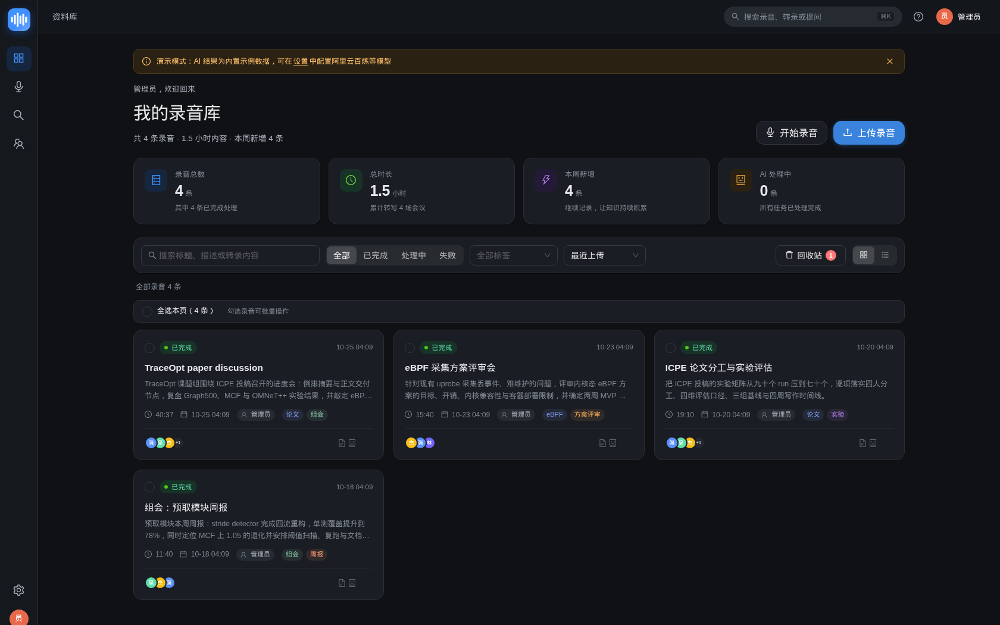
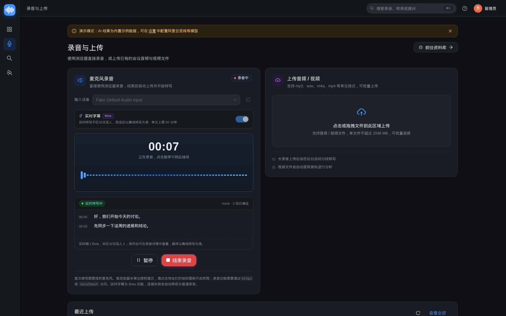
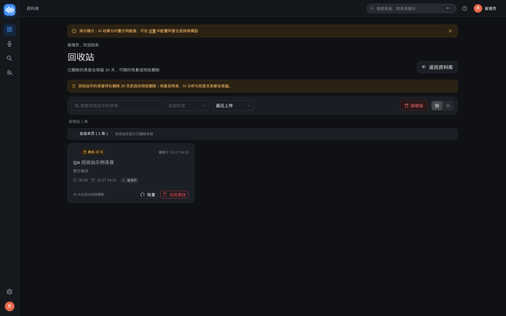
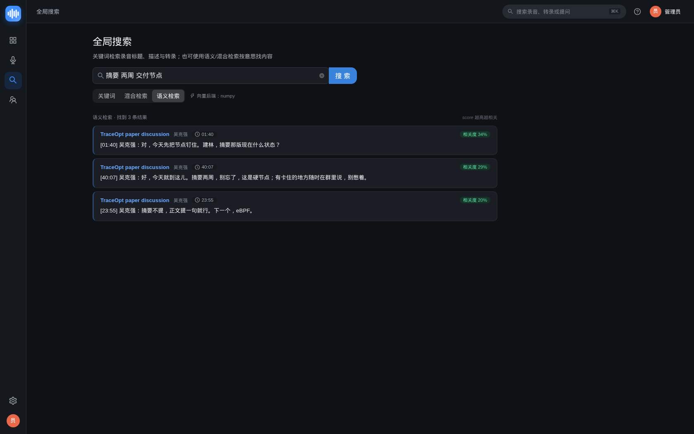
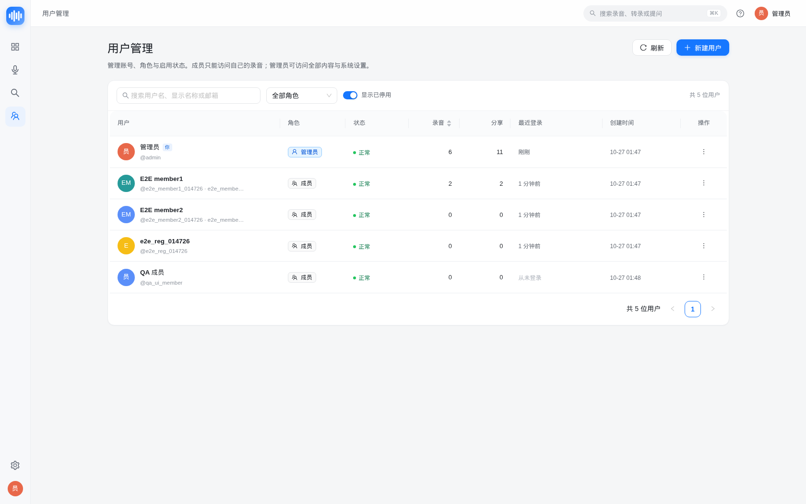
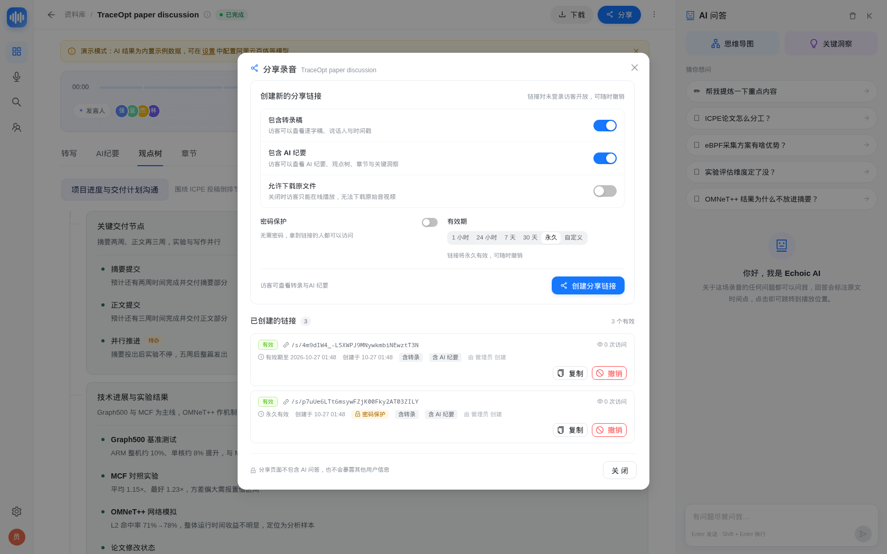
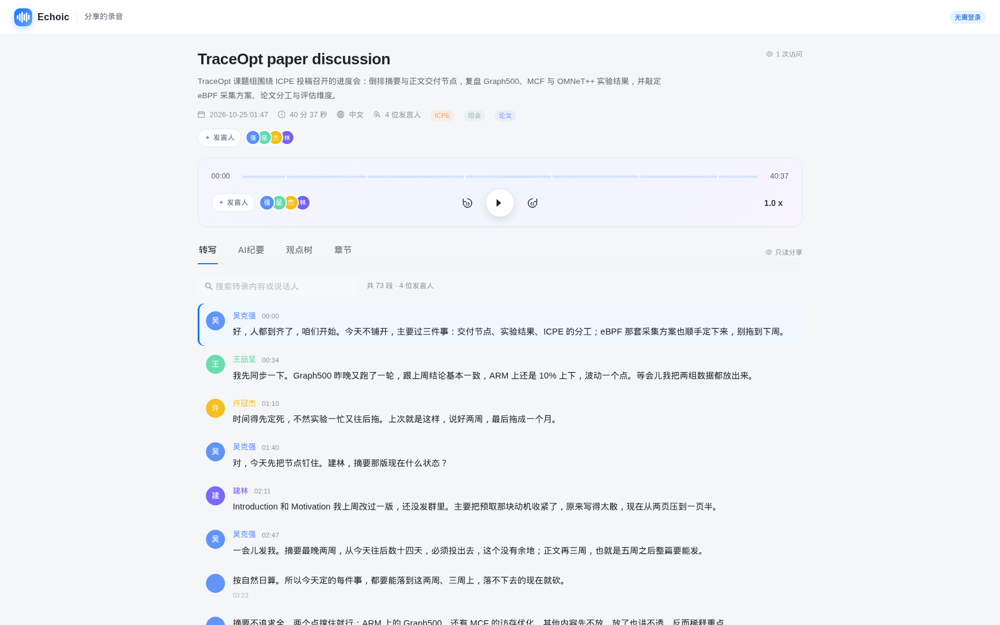
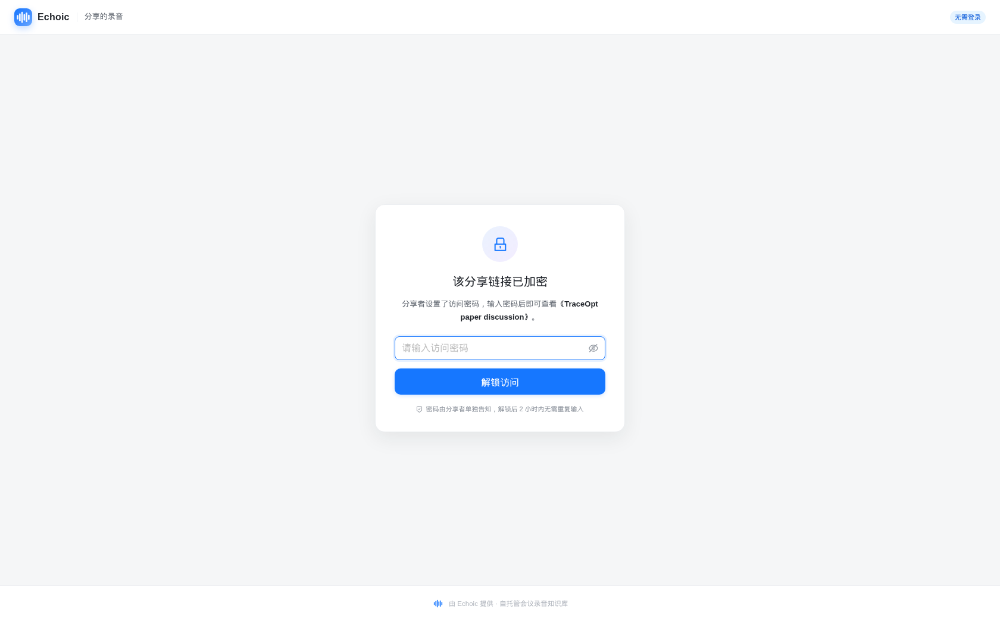

# Echoic

[English](README.md) | **简体中文**

[](https://github.com/wpcwzy/echoic/actions/workflows/ci.yml)
[](https://github.com/wpcwzy/echoic/actions/workflows/docker-publish.yml)
[](https://github.com/wpcwzy/echoic/pkgs/container/echoic)
[](LICENSE)

> 自托管的私人**会议 / 通话 / 录音 / 视频知识库**。
> 上传或网页录制声音，自动获得**转录稿、AI 纪要、观点树 & 思维导图、章节、关键洞察、待办与 AI 问答**——所有数据都留在你自己的服务器上。

- 定位：paperless-ngx 之于纸质文档 = **Echoic 之于录音**
- 版本：**v0.3.1**（P1 全部交付：暗色主题 / 回收站与批量 / 对象存储 / 实时转写 Beta / 向量混合检索 + 多用户分享 + GitHub CI + GHCR 多架构镜像）
- 许可：MIT

## 📸 界面预览

> 以下截图来自本仓库真实运行的 Demo 数据（1680×1050），完整截图见 [`docs/screenshots/`](docs/screenshots/)。

| 资料库 | 详情页 · 观点树 |
|---|---|
|  |  |

| AI 思维导图 | 设置 · AI 服务 |
|---|---|
|  |  |

**v0.3 暗色、回收站、实时与检索**

| 资料库 · 暗色 | 实时字幕（录音页） |
|---|---|
|  |  |

| 回收站与批量操作 | 语义 / 混合搜索 |
|---|---|
|  |  |

**v0.2 协作与分享**

| 用户与角色管理 | 分享链接创建 |
|---|---|
|  |  |

| 公开分享页（免登录） | 密码保护分享 |
|---|---|
|  |  |

---

## ✨ 功能特性

| 能力 | 说明 |
|---|---|
| 🎙 网页录音 + 上传 | 浏览器直接麦克风录音（计时/暂停/电平表）；支持 mp3/wav/m4a/aac/ogg/webm/mp4/mov/mkv，单文件 ≤ 2GB |
| 📝 语音转写 | 可配置阿里云百炼 DashScope / OpenAI 兼容 Whisper / Mock；输出带说话人和时间戳的分段转录稿，可改名、可编辑 |
| 🧠 AI 纪要 | Markdown 概述 + 关键结论 + 决议 + 待办；支持重新生成 |
| 🌳 观点树 & 思维导图 | 结构化观点树，React Flow 思维导图可视化，点击节点跳转对应录音时间 |
| 📑 智能章节 | 自动切分章节（标题/时间区间/摘要/bullets），点击跳播 |
| 💬 AI 问答 | 基于转录稿 + 纪要的 RAG 问答，SSE 流式输出，答案带 `[12:05]` 时间戳引用，可点击定位 |
| 📚 资料库 | 搜索 / 状态筛选 / 标签 / 排序 / 统计卡片；全局搜索定位到录音片段 |
| 🎧 播放器 | 进度拖动、±15 秒、倍速、当前段落高亮自动滚动、HTTP Range 按需加载 |
| 💾 数据自持 | SQLite（可选 PostgreSQL）+ 本地媒体目录；备份 = 打包一个数据卷 |
| 🔐 安全 | HttpOnly Cookie JWT、bcrypt 密码、Fernet 加密 API Key（仅回掩码）、上传校验、登录限速 |
| 🎭 演示模式 | 零 API Key、零外网也能完整跑通全流程（内置示例录音与全套 AI 结果） |
| 👥 多用户与角色 | `admin`/`member` 两级角色；管理员用户管理（创建/编辑/停用/重置密码/删除）、开放注册开关；录音按所有者隔离，管理员可转移归属；账号停用即时失效会话 |
| 🔗 公开分享链接 | 详情页一键分享：可选密码、有效期（1h–永久）、是否含转录/纪要、是否允许下载；免登录只读页 `/s/{token}`，支持撤销与访问计数 |
| 📥 consume 目录导入 | 把音视频丢进 `data/consume/` 自动入库并处理（paperless 式）；sha256 去重、失败隔离到 `failed/`，设置页可查看状态并手动扫描 |
| 🌙 暗色主题 | 浅色 / 深色 / 跟随系统三态切换，浏览器持久化、刷新无闪烁；覆盖全部页面、弹窗、思维导图、播放器与公开分享页 |
| 🗑 回收站与批量操作 | 软删除（默认保留 30 天）、恢复、彻底删除、删除时自动撤销分享；多选批量移入回收站/恢复/重跑/打标签，部分成功提示与撤销 Toast |
| 🪣 对象存储 | 可插拔 `local` / S3 兼容（MinIO）后端；管线 staging、Range 媒体代理、可选 307 预签名、删除级联、local↔S3 迁移 CLI |
| 🎙 实时转写（Beta） | WebSocket + PCM 采集的录音实时字幕；Mock 离线可演示、DashScope paraformer-realtime；`replace` / `promote` 合并策略 |
| 🔎 语义与混合检索 | 转录切片向量索引（默认 numpy，实验性 pgvector）+ RRF 混合检索与 ACL；搜索页语义/混合模式、索引状态与重建、AI 问答混合 RAG |
| 📤 数据导出 | 转录稿导出 TXT / SRT / Markdown / JSON |
| 🐳 一键部署 | **GHCR 预构建多架构镜像**（amd64/arm64，CI 自动发布）+ docker compose 镜像优先部署，`pull && up -d` 即用；亦可源码构建；可切独立 worker / PostgreSQL |

---

## 🏗 架构一览

```
┌──────────────────────────── 浏览器（React 18 + TS + Vite + AntD 5）────────────────────────────┐
│  资料库 · 录音上传 · 详情页(转写 | AI纪要 | 观点树 | 章节) · AI问答面板 · 思维导图 · 设置 · 用户  │
│  公开分享页                                                                                     │
└───────────────────────────────────────────┬─────────────────────────────────────────────────────┘
                                            │ 同源 HTTPS · HttpOnly Cookie JWT · SSE
┌───────────────────────────────────────────▼─────────────────────────────────────────────────────┐
│ FastAPI（单进程，uvicorn）                                                                      │
│  /api/auth /api/recordings /transcript /insights /chat(SSE) /search /tags /settings …           │
│  /api/users /api/shares /api/public/shares /api/system/consume …                                │
│  ├─ core：config · security · crypto · storage · media(ffmpeg)                                   │
│  ├─ providers：ASR / LLM / Embedding 可插拔（mock / DashScope / OpenAI 兼容）                     │
│  ├─ services：pipeline 处理管线 · queue 任务队列 · chat RAG · analysis · consume · demo           │
│  └─ 内嵌 worker 线程（可切独立进程）；生产模式直接托管前端静态资源                                 │
└──────┬──────────────────────────────────────────────┬───────────────────────────────────────────┘
       │ SQLAlchemy 2.0                               │ 本地文件系统（挂载卷 /data）
┌──────▼──────────────┐                    ┌──────────▼────────────────────────────────────────────┐
│ SQLite (默认，WAL)   │                    │ echoic.db · secret.key · media/{uuid}/…               │
│ PostgreSQL (可选)    │                    │ original.* · playback.m4a · asr.wav                   │
└─────────────────────┘                    └───────────────────────────────────────────────────────┘
       │
       ▼ 仅出站 HTTPS（可用自建/内网兼容端点替代）
  阿里云百炼 DashScope（paraformer ASR / qwen LLM / embedding）
  OpenAI 兼容 LLM（DeepSeek / Ollama / vLLM / LM Studio…）
  Whisper 兼容 ASR（OpenAI / faster-whisper-server / FunASR…）
```

处理管线：

```
upload/record → 落盘 + ffprobe → [prepare] 标准化 16k wav + playback.m4a
             → [transcribe] ASR（说话人分离）→ [analyze] LLM 纪要/章节/观点树/洞察/待办
             → [embed] 切片+向量（可选）→ [finalize] status=ready
失败 → status=failed + 中文 error_message，可重试；进度写 progress/stage 供前端轮询
```

更多设计细节：[ARCHITECTURE.md](docs/ARCHITECTURE.md) · [PIPELINE.md](docs/PIPELINE.md) · [API.md](docs/API.md) · [FRONTEND.md](docs/FRONTEND.md)

---

## 🚀 快速开始（Docker 镜像，推荐）

无需本地构建：直接拉取 CI 自动发布的**多架构预构建镜像**（linux/amd64 + linux/arm64）。

```bash
# 1. 准备环境变量（至少修改管理员口令）
cp .env.example .env
vi .env                    # 修改 ECHOIC_ADMIN_PASSWORD（默认 admin123 仅用于首次体验）

# 2. 拉取预构建镜像并启动（默认 ghcr.io/wpcwzy/echoic:latest）
docker compose pull
docker compose up -d

# 3. 浏览器打开 http://localhost:8000，用 admin / <你设置的口令> 登录
```

- 镜像：`ghcr.io/wpcwzy/echoic`，标签 `latest`（main 最新）/ `v0.2.0` 等语义化版本 / `sha-xxxxxxx`；
  在 `.env` 中用 `ECHOIC_IMAGE_TAG` 选择（生产建议固定版本，如 `v0.2.0`）；
- **GHCR 包已设为 Public**（匿名可拉取），`docker compose pull` 无需登录；
  若遇到 403（例如包被重新设为私有），请先 `docker login ghcr.io` 或把包可见性改为 Public
  （详见 [docs/DEPLOYMENT.md](docs/DEPLOYMENT.md) §3.2）；
- 默认 **mock 演示模式**：无需任何 API Key，启动即有示例录音与全套 AI 结果；
- 接入真实模型：在「设置 → AI 服务」填写 DashScope / OpenAI 兼容端点的 Key 与模型，点「测试连接」即可；
- 数据/媒体/密钥全部落在 `echoic-data` 卷，备份该卷即可迁移。

### 从源码构建（可选）

```bash
# 适合开发 / 定制 / 离线环境；构建产物为本地镜像 echoic:local，不覆盖官方镜像标签
docker compose -f docker-compose.yml -f docker-compose.build.yml up -d --build
```

完整部署（反向代理、备份恢复、升级、PostgreSQL、独立 worker、故障排查）见 **[docs/DEPLOYMENT.md](docs/DEPLOYMENT.md)**。

---

## 🐳 容器镜像与 CI/CD

| 项目 | 说明 |
|---|---|
| 镜像地址 | `ghcr.io/wpcwzy/echoic`（GitHub Container Registry） |
| 架构 | `linux/amd64` + `linux/arm64` 多架构 manifest（x86 服务器 / Apple Silicon / ARM 云主机均可直接拉取） |
| 标签 | `latest`（main 每次推送）、`vX.Y.Z` / `X.Y` / `X`（推送 git tag 时自动生成）、`sha-xxxxxxx`（每次构建，可复现 / 回滚） |
| 发布流水线 | [`.github/workflows/docker-publish.yml`](.github/workflows/docker-publish.yml)：QEMU + Buildx 多架构构建 → GHCR；BuildKit GHA 缓存 + provenance 构建证明 |
| 持续集成 | [`.github/workflows/ci.yml`](.github/workflows/ci.yml)：后端 pytest（含 ffmpeg）+ 前端 tsc / vite 构建 + PR 镜像构建（amd64，不推送） |
| 依赖更新 | [`.github/dependabot.yml`](.github/dependabot.yml)：pip / npm / GitHub Actions / Docker 基础镜像每周自动检查 |

**发布新版本**（维护者）：

```bash
git tag -a v0.2.0 -m "Echoic v0.2.0" && git push origin v0.2.0   # 自动构建并发布 v0.2.0 / 0.2 / 0 标签
docker pull ghcr.io/wpcwzy/echoic:v0.2.0                          # 发布后验证
```

**GHCR 包可见性（首次发布后做一次）**：GitHub 默认新包为私有，匿名 `docker pull` 会 403。发布流水线末尾会用 `GITHUB_TOKEN`
尝试自动改为 public（`continue-on-error`，多数环境无此权限）；若未生效，请到
<https://github.com/users/wpcwzy/packages/container/echoic/settings> → Danger Zone → Change visibility → **Public**，
或使用具备 `write:packages` 权限的 PAT：

```bash
echo "<PAT>" | docker login ghcr.io -u wpcwzy --password-stdin
docker pull ghcr.io/wpcwzy/echoic:latest
```

---

## ✅ 验证状态（v0.2.0）

| 项目 | 结果 | 证据 |
|---|---|---|
| GitHub Actions CI | **通过**：后端 pytest + 前端 tsc/vite 构建；PR 额外验证 amd64 镜像构建 | [CI 运行记录](https://github.com/wpcwzy/echoic/actions/workflows/ci.yml) |
| 多架构镜像发布 | **成功**：linux/amd64 + linux/arm64 已推送 GHCR（`latest` / `sha-*`；tag 发布语义化版本） | [Publish 运行记录](https://github.com/wpcwzy/echoic/actions/workflows/docker-publish.yml) · [GHCR 包](https://github.com/wpcwzy/echoic/pkgs/container/echoic) |
| 后端测试 | **395 passed**（v0.1 129 + v0.2 + v0.3 回收站/实时/向量/存储/迁移）；含 moto S3 上传→管线→Range 端到端用例 | `cd backend && .venv/bin/pytest -q` |
| 前端构建 | **通过**（`tsc --noEmit` 零错误；gzip ≈ 613 KB JS + 22 KB CSS） | `cd frontend && npm run build` |
| 端到端冒烟（Mock，全新数据库） | v0.1 **30/30** + v0.2 **34/34** + v0.3 **34/34 PASS**：回收站/批量不变量、实时 Mock WS→上传→replace/promote、向量重建+语义/混合检索 ACL、Range、回归 | [`e2e/REPORT-v0.3.md`](e2e/REPORT-v0.3.md) |
| UI 截图巡检 | v0.1 6/6 + v0.2 7/7 + v0.3 8/8（明暗、桌面/移动），无溢出、无未捕获异常、无 5xx | [`docs/screenshots/`](docs/screenshots/) · [`docs/screenshots/v0.3/`](docs/screenshots/v0.3/) |
| 对象存储 | local/S3 后端、媒体代理、迁移 CLI 单测 + moto；S3 上传→管线→Range 端到端 pytest | `pytest tests/test_storage_*.py` |

---

## 🛠 开发指南

依赖：Python 3.11+（推荐 3.12）、Node.js 20+（推荐 22）、ffmpeg。

```bash
# 后端 + 前端（热更新）：后端 http://127.0.0.1:8000，前端 http://localhost:5173
./scripts/dev.sh

# 类生产本地运行：构建前端后由 FastAPI 同源托管，:8100
./scripts/run-local.sh

# 一键验证：pytest + 前端类型检查/构建 + 健康检查 + e2e 冒烟
./scripts/verify.sh
```

手工方式：

```bash
# 后端
cd backend
python3 -m venv .venv && .venv/bin/pip install -r requirements-dev.txt
.venv/bin/uvicorn app.main:app --reload --port 8000

# 前端（dev server 已代理 /api → :8000）
cd frontend
npm ci        # 或 npm install
npm run dev
```

目录结构：

```
backend/app/{api,core,providers,services}   FastAPI 应用与插件式 AI provider
backend/app/{main.py,config.py,models.py,…} 应用装配 / 配置 / ORM / DTO
frontend/src/{pages,components,layouts,api} React 前端
docker/{entrypoint.sh}                      容器入口脚本
scripts/{dev.sh,run-local.sh,verify.sh}     本地开发 / 验收脚本
docs/                                       架构、管线、API、前端、部署文档
e2e/                                        端到端冒烟脚本与验收报告
```

---

## ⚙️ 配置说明

所有配置均可通过环境变量 `ECHOIC_*` 或 `backend/.env` / 仓库根目录 `.env` 覆盖，完整清单与注释见 [.env.example](.env.example)。常改项：

| 变量 | 默认 | 说明 |
|---|---|---|
| `ECHOIC_ADMIN_USERNAME` / `ECHOIC_ADMIN_PASSWORD` | `admin` / `admin123` | 首次启动创建的管理员（之后请在设置页改密） |
| `ECHOIC_SECRET_KEY` | 自动生成 | JWT / API Key 加密密钥；留空自动生成到数据目录 |
| `ECHOIC_DATA_DIR` | `./data`（Docker 内 `/data`） | SQLite、媒体、密钥存放目录 |
| `ECHOIC_DATABASE_URL` | 空（SQLite） | 可指向 PostgreSQL：`postgresql+psycopg://…` |
| `ECHOIC_DEMO_SEED` | `true` | 空库时写入内置演示录音 |
| `ECHOIC_EMBEDDED_WORKER` | `true` | 内嵌任务线程；独立 worker 部署时设 `false` |
| `ECHOIC_MAX_UPLOAD_MB` | `2048` | 单文件上传上限 |
| `ECHOIC_IMAGE_TAG` | `latest` | **部署**：GHCR 镜像标签（`latest` / `v0.2.0` / `sha-xxxxxxx`） |
| `ECHOIC_ALLOW_REGISTRATION` | `false` | v0.2：开放网页注册（默认仅管理员建号） |
| `ECHOIC_SHARE_COOKIE_HOURS` | `2` | v0.2：公开分享链接解锁 Cookie 有效期（小时） |
| `ECHOIC_CONSUME_ENABLED` | `true` | v0.2：监听 consume 目录自动导入录音 |
| `ECHOIC_CONSUME_DIR` | 空（`<data>/consume`） | v0.2：consume 目录（Docker 内即 `/data/consume`，随数据卷持久化） |
| `ECHOIC_CONSUME_INTERVAL_SEC` | `15` | v0.2：consume 扫描间隔（秒） |
| `ECHOIC_CONSUME_OWNER_USERNAME` | 空（首个管理员） | v0.2：导入录音归属用户 |
| `ECHOIC_ASR_PROVIDER` / `ECHOIC_LLM_PROVIDER` | `mock` / `mock` | AI provider（mock / dashscope_realtime / openai …） |
| `ECHOIC_ASR_API_KEY` / `ECHOIC_LLM_API_KEY` | 空 | 服务商密钥（首次启动写入数据库；网页设置优先） |

> 提示：`.env` 中的 `ECHOIC_*AI*` 配置**只在首次启动写入数据库**，之后请在「设置」页面修改（即时生效、Key 加密存储）。

---

## 🗺 Roadmap

### v0.2.0（P1 batch 1，已交付）

- [x] 多架构容器镜像 + GHCR 自动发布 + GitHub Actions CI/CD（镜像优先 compose 部署）
- [x] 多用户 / 角色权限（管理员 / 成员）+ 用户管理 + 开放注册开关
- [x] 公开分享链接（密码 / 有效期 / 权限开关 / 只读分享页 / 撤销 / 访问计数）
- [x] consume 目录自动导入（监听文件夹自动建录音并处理 + 去重 + 失败隔离）
- [x] 数据库迁移机制与 v0.1 升级兼容

### v0.3.0（P1 全部交付，已发布）

- [x] 暗色主题（浅色 / 深色 / 跟随系统）全站覆盖
- [x] 回收站与批量操作（保留期、恢复/彻底删除、删除自动撤销分享）
- [x] 对象存储抽象（local / S3 / MinIO）+ 迁移 CLI
- [x] 实时转写 Beta（Mock + DashScope 实时，replace/promote 合并）
- [x] 向量/混合语义检索、索引重建、AI 问答混合 RAG
- [x] v0.1/v0.2 数据目录自动迁移

### 后续（v0.3.x / v1.0）

- [ ] sqlite-vec 后端、pgvector 真机验证、实时转写 GA（自动重连、真实 Key 长稳）
- [ ] 自助注册页面、成员个人资料/改密页
- [ ] 视频画面 PPT / 场景抽取、移动 App / 浏览器扩展、OAuth/LDAP、审计日志

---

## 📄 License

[MIT License](LICENSE) © 2026 Echoic contributors.

---

## 🔗 文档索引

| 文档 | 内容 |
|---|---|
| [docs/ARCHITECTURE.md](docs/ARCHITECTURE.md) | 目标/非目标、总体架构、数据模型、安全设计 |
| [docs/PIPELINE.md](docs/PIPELINE.md) | 处理管线、任务队列、provider 接口、mock 行为 |
| [docs/API.md](docs/API.md) | REST + SSE 接口契约（前后端唯一事实来源） |
| [docs/FRONTEND.md](docs/FRONTEND.md) | 页面/路由/组件/视觉规范 |
| [docs/DEPLOYMENT.md](docs/DEPLOYMENT.md) | 中文部署指南（Docker、备份、升级、排障） |
| [docs/08-P1-协作与分享设计.md](docs/08-P1-协作与分享设计.md) | v0.2 契约：角色权限、分享链接、consume、迁移 |
| [docs/09-P1-后续能力技术方案.md](docs/09-P1-后续能力技术方案.md) | P1 技术方案：实时转写 / 向量检索 / 对象存储 / 回收站 / 暗色主题 |
| [docs/10-v0.3.0-实现契约.md](docs/10-v0.3.0-实现契约.md) | v0.3.0 实现契约：回收站/批量、暗色、存储、实时、向量 |
| [e2e/REPORT.md](e2e/REPORT.md) · [e2e/REPORT-v0.2.md](e2e/REPORT-v0.2.md) · [e2e/REPORT-v0.3.md](e2e/REPORT-v0.3.md) | 端到端验收报告（v0.1 / v0.2 / v0.3） |
| [CHANGELOG.md](CHANGELOG.md) | 版本变更记录与已知限制 |
